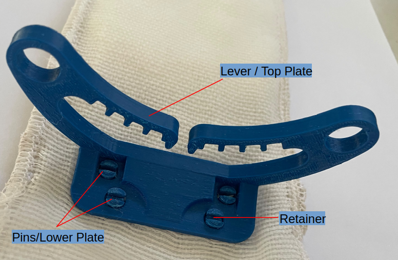

# compression-lever-bandage

## Project Summary
### Overview
Inside Gaza there is little access to compression bandages for wound stabilization and TQ conversions both in the pre-hospital and hospital environments. The best performing compression bandages utilize a compressive fabric combined with a fixed plastic "lever", and fixed plastic attachment for securing ([Rescue Essentials Israeli Emergency Bandage](https://rescue-essentials.com/products/israeli-emergency-bandage))[cite: 1]. 

However, these products use complex components that are injection molded and then assembled using high-performance adhesives[cite: 1]. This makes trying to duplicate the current in-market designs not possible with the materials and tooling available[cite: 1]. The open-source community has investigated manufacturing these bandages using 3D printing technology ([Deuxfleurs 3D-Printed Emergency Compression Lever](https://git.deuxfleurs.fr/distorsion/3D-printed-emergency-compression-lever/src/branch/main)) in order to try and provide a way for low-resource areas to get the same performance of the in-market products, but without needing the associated complex manufacturing processes[cite: 1].

### Proposal
The goal of this project is to test the feasibility of producing a pressure bandage that functions at a high enough level to be utilized in both the pre-hospital and hospital environments within Gaza[cite: 1].

---

## Design
The open-source community has an available design ([Deuxfleurs Link](https://git.deuxfleurs.fr/distorsion/3D-printed-emergency-compression-lever/src/branch/main)), but it requires thicker plastic sections, and metal fastening hardware[cite: 1]. In Gaza, having access to the metal hardware would be difficult, and the assembly with the hardware could add complexity that would impact scalability[cite: 1]. Further, a design with less plastic overall would be more favorable for both cost and time savings[cite: 1]. Therefore, we developed a modified version with these core concepts[cite: 1]:
* The lever and base plate just snap together requiring no special manufacturing process or education[cite: 1].
* It should require no extra hardware and be quick to manufacture[cite: 1].
* It should be lightweight and easy to handle while sewing in the other bandage components[cite: 1].
* All resources should be readily available in Gaza[cite: 1].

The final design of the lever portion of the bandage is 3D printed from **ABS**, has 4 locking pins, 2 retainers, and no other hardware or components to keep it in place and operational at full strength[cite: 1]. 

The other design area to consider is the bandage itself[cite: 1]. In the open-source community, they were using single bandages, either thinner crepe style that lacked strength, or thicker elastic versions that are harder to find inside the Gaza markets[cite: 1]. Therefore, the team worked with a local tailor who was able to sew 2 of the lighter-weight bandages together using a flexible stitch[cite: 1]. This resulted in a thicker bandage that had good elastic properties, but was still able to be sourced completely in the local markets[cite: 1].

---

## Final Product
* **Video Demo:** See `Media/bandage.mp4`[cite: 1].

---

## Manufacturing Instructions

### 1. Sewing
See the diagram below for sewing specs and guidelines[cite: 1]. The 12 cm in the front of the bandage is left unsewn to act as the "arm" catch in case of one-handed application[cite: 1]. The clip at the end of the bandage is sewn in during this process by simply folding over 1.5 cm of the bandage material[cite: 1].

### 2. Snap Plate Assembly

* Insert the bottom plate between the bandage pouch and the bandage; make sure the pins are facing the bandage and not the pouch[cite: 1].
* The orientation of the pins should be such that the plate of the lever is facing away from the beginning of the bandage[cite: 1].
* Push the pins through the bandage fabric by gently massaging the fabric matrix while applying gentle pressure[cite: 1].
* Once the pins are pushed through the fabric, place the bandage and pins on a hard flat surface[cite: 1].
* Place the lever over the pins, aligning them before applying firm direct pressure to snap them into place[cite: 1].
* *(See video `Media/snapplate_Assembly.mp4` for visual assembly guide)*[cite: 1]

---

## Testing
From some documented sensor-based trials of the market-branded bandage ([Survival Metrics Report](https://www.survivalmetrics.com/media/images/gallery/Emergency-Bandage-Report-2007-TAMU.pdf)), we can see 30 PSI being measured (across a 0.40" diameter sensor), which would translate to roughly ~3.77 lbs of absolute force[cite: 1].

With our bandage currently hitting estimated force levels between 5–10 lbs, we are more confident that the product is capable of performing properly in its intended medical intervention role[cite: 1].

* *(See video `Media/lever_4pin_retainer_test.mp4`)*[cite: 1]

---

## QA (Not Complete)
* QA testing and protocols in progress[cite: 1].
